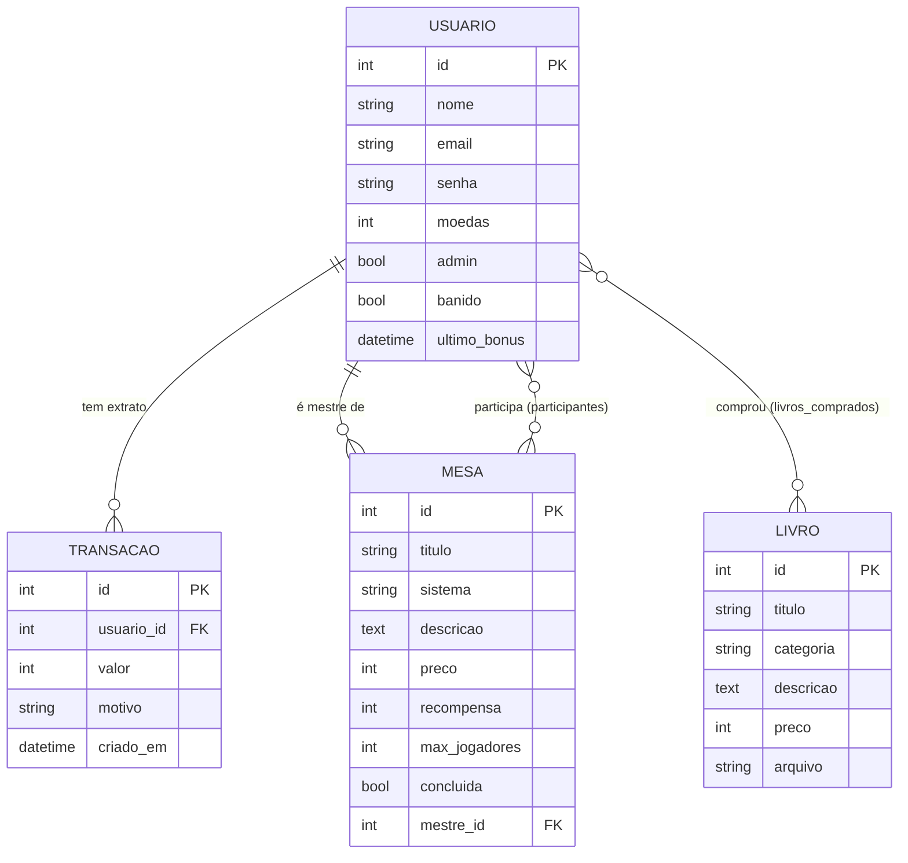

# Guilda Arcana: documentação completa para estudo

Documento de estudo do projeto **Guilda Arcana**, um site de RPG feito em **Python + Flask**, com **programação orientada a objetos (POO)** e banco de dados **SQLite**.

## Sumário

1. [Resumo do projeto](#1-resumo-do-projeto)
2. [Classes e POO](#2-classes-e-poo-quantas-classes-existem)
3. [Arquitetura: como tudo se conecta](#3-arquitetura-como-tudo-se-conecta)
4. [Banco de dados](#4-banco-de-dados)
5. [models.py explicado](#5-modelspy-explicado)
6. [app.py explicado](#6-apppy-explicado)
7. [Templates HTML explicados](#7-templates-html-explicados)
8. [CSS explicado](#8-css-explicado)
9. [Fluxos completos passo a passo](#9-fluxos-completos-passo-a-passo)
10. [Perguntas e respostas para a apresentação](#10-perguntas-e-respostas-para-a-apresentação)
11. [Glossário](#11-glossário)
12. [Limitações conhecidas](#13-limitações-conhecidas)

---

## 1. Resumo do projeto

**O que é:** uma plataforma onde jogadores de RPG encontram **mesas** (sessões de jogo) e **livros** em PDF, usando uma **moeda** do próprio site.

**Quem pode fazer o quê:**

| Perfil | Pode |
|---|---|
| Visitante (sem conta) | Ver as listas de mesas e livros e buscar. |
| Usuário logado | Criar e entrar em mesas, comprar e baixar livros, comprar moedas (simulado), resgatar o bônus diário, ver perfil e extrato. |
| Admin (`ADMIN` / `258741`) | Tudo acima, mais: adicionar e remover mesas e livros, ver todas as contas, banir, apagar e dar moedas. |

**Como a moeda funciona:** o usuário começa com 100 moedas. Ganha mais com o bônus diário (20), concluindo mesas (recompensa definida pela mesa) ou comprando pacotes. Gasta entrando em mesas pagas e comprando livros pagos.

**Tecnologias:**

| Tecnologia | Papel no projeto |
|---|---|
| Python | Linguagem do projeto. |
| Flask | Framework web: recebe as requisições e devolve as páginas. |
| Flask-SQLAlchemy | ORM: transforma classes Python em tabelas do banco. |
| Flask-Login | Controla quem está logado (sessão). |
| SQLite | Banco de dados em um único arquivo (`instance/rpg.db`). |
| Jinja2 | Linguagem dos templates HTML (vem com o Flask). |
| HTML + CSS | Telas e visual. |

**Estrutura de arquivos:**

```
rpg_site/
├── app.py              # rotas e configuração do site
├── models.py           # classes (tabelas) e regras de negócio
├── requirements.txt    # bibliotecas
├── templates/          # base, login, registro, mesas, livros, moeda, perfil, admin
├── static/style.css    # visual
└── instance/           # criada sozinha: rpg.db (banco) e livro
```

---

## 2. Classes e POO

**O projeto tem exatamente 4 classes criadas.**

| # | Classe | Arquivo | Representa | Herda de |
|---|---|---|---|---|
| 1 | `Transacao` | models.py | Uma movimentação no extrato de moedas | `db.Model` |
| 2 | `Usuario` | models.py | A conta de um jogador ou admin | `UserMixin`, `db.Model` |
| 3 | `Mesa` | models.py | Uma sessão de RPG | `db.Model` |
| 4 | `Livro` | models.py | Um PDF à venda ou grátis | `db.Model` |

**O que parece ser uma classe, mais não é**
- `participantes` e `livros_comprados` são `db.Table`: tabelas de ligação criadas com um objeto da biblioteca.
- `db` (`SQLAlchemy()`), `app` (`Flask(...)`) e `login` (`LoginManager`) são **objetos** de classes das bibliotecas.
- `admin_required` é uma **função**, não uma classe.

### Conceitos de POO presentes no código

| Conceito | Onde aparece | Explicação |
|---|---|---|
| **Classe e objeto** | `class Mesa(...)`, `Mesa(titulo="...")` | A classe é o molde, e cada mesa criada é um objeto. |
| **Atributos** | `titulo`, `preco`, `moedas`... | Os dados que cada objeto guarda. |
| **Métodos** | `entrar()`, `concluir()`, `debitar()`... | O comportamento do objeto. |
| **Encapsulamento** | `debitar()` e `creditar()` | O saldo só é alterado por métodos que validam e registram no extrato. As rotas não mexem no saldo diretamente. |
| **Herança** | `Usuario(UserMixin, db.Model)` | `Usuario` herda os métodos de login do `UserMixin` e o comportamento de tabela do `db.Model`. Todas as 4 classes herdam de `db.Model`. |
| **Associação e composição** | `db.relationship(...)` | Mesa tem jogadores e mestre. Usuário tem transações. Livro tem compradores. Apagar um usuário apaga suas transações (`cascade`). |
| **Abstração** | `Mesa.entrar(usuario)` | Quem chama não precisa saber as validações internas. |
| **Tratamento de exceções** | `raise ValueError` + `except ValueError` | As classes lançam o erro, e as rotas o capturam e mostram a mensagem. |
| **Constante de classe** | `Usuario.BONUS_DIARIO = 20` | Valor compartilhado por todos os objetos da classe. |

---

## 3. Arquitetura: como tudo se conecta

O projeto separa responsabilidades em camadas:

| Camada | Arquivo | Responsabilidade |
|---|---|---|
| **Modelo** (dados e regras) | `models.py` | O que existe (Usuário, Mesa...) e o que cada um faz (entrar, comprar...). |
| **Controle** (rotas) | `app.py` | Recebe o pedido, chama o modelo e decide o que mostrar. |
| **Visão** (telas) | `templates/` + `static/` | O HTML e o CSS que o usuário vê. |

Esse padrão se parece com o **MVC**. A regra importante: **a lógica fica nos modelos**, e as rotas só coordenam.

**O caminho de uma requisição** (ex.: clicar em "Entrar" numa mesa):

```
Navegador ──POST /mesas/3/entrar──▶ Flask (rota entrar_mesa em app.py)
                                         │ chama m.entrar(current_user)
                                         ▼
                                  models.py (Mesa.entrar → Usuario.debitar)
                                         │ db.session.commit()
                                         ▼
                                  SQLite (instance/rpg.db)
                                         │
Navegador ◀──redirect /mesas── Flask ◀───┘  mostra a mensagem com flash
```

---

## 4. Banco de dados

### 4.1 Conceitos

- **Banco de dados:** onde as informações ficam guardadas de forma permanente (contas, mesas, livros...).
- **SQLite:** um banco em um **único arquivo** (`instance/rpg.db`), sem servidor para instalar. Ideal para projetos escolares e pequenos.
- **Tabela:** como uma planilha. Cada **linha** é um registro e cada **coluna** é um campo.
- **Chave primária (PK):** identificador único da linha (o `id`).
- **Chave estrangeira (FK):** coluna que aponta para a PK de outra tabela (ex.: `mestre_id` aponta para `usuario.id`).
- **ORM (SQLAlchemy):** em vez de escrever SQL, usamos classes Python. Cada classe vira uma tabela, e cada objeto vira uma linha.
- **`db.create_all()`:** cria as tabelas que ainda não existem. Ele **não altera** tabelas já criadas. Por isso, quando uma coluna muda, é preciso apagar o `rpg.db`.

O arquivo `rpg.db` é **binário**, então não abre no Bloco de Notas. Se Desejar abrir tem que usar o **DB Browser for SQLite** (sqlitebrowser.org) ou a extensão *SQLite Viewer* do VS Code.

### 4.2 Diagrama das tabelas



### 4.3 Tabelas e colunas

**`usuario`**

| Coluna | Tipo | Regra | Para que serve |
|---|---|---|---|
| `id` | Integer | PK | Identificador da conta |
| `nome` | String(60) | único, obrigatório | Nome de aventureiro (também usado no login) |
| `email` | String(120) | único, obrigatório | E-mail (também usado no login) |
| `senha` | String(128) | obrigatório | Senha (**em texto puro**, sem hash) |
| `moedas` | Integer | padrão 100 | Saldo |
| `admin` | Boolean | padrão falso | Se é administrador |
| `banido` | Boolean | padrão falso | Se está banido |
| `ultimo_bonus` | DateTime | pode ser vazio | Quando resgatou o último bônus diário |

**`transacao`** (extrato)

| Coluna | Tipo | Para que serve |
|---|---|---|
| `id` | Integer (PK) | Identificador |
| `usuario_id` | FK → `usuario.id` | De quem é a movimentação |
| `valor` | Integer | Positivo = entrada, negativo = saída |
| `motivo` | String(120) | Ex.: "Livro: Crônicas de Eldoria" |
| `criado_em` | DateTime | Data e hora (preenchida automaticamente) |

**`mesa`**

| Coluna | Tipo | Para que serve |
|---|---|---|
| `id` | Integer (PK) | Identificador |
| `titulo` | String(100) | Nome da mesa |
| `sistema` | String(60) | D&D 5e, Tormenta20... |
| `descricao` | Text | Texto livre |
| `preco` | Integer | Moedas para entrar (0 = grátis) |
| `recompensa` | Integer | Moedas que cada jogador ganha ao concluir |
| `max_jogadores` | Integer | Limite de vagas |
| `concluida` | Boolean | Se a mesa já foi concluída |
| `mestre_id` | FK → `usuario.id` | Quem criou e conduz a mesa |

**`livro`**

| Coluna | Tipo | Para que serve |
|---|---|---|
| `id` | Integer (PK) | Identificador |
| `titulo`, `categoria`, `descricao` | texto | Informações exibidas |
| `preco` | Integer | Moedas (0 = grátis) |
| `arquivo` | String(200) | Nome do PDF salvo em `instance/livros/` |

**`participantes`** (tabela de ligação): `usuario_id` + `mesa_id`. Cada linha significa "este usuário está nesta mesa".

**`livros_comprados`** (tabela de ligação): `usuario_id` + `livro_id`. Cada linha significa "este usuário comprou este livro".

### 4.4 Tipos de relacionamento

| Relação | Tipo | Como foi feita |
|---|---|---|
| Usuário → Transações | **1 para N** (um usuário tem várias transações) | `Transacao.usuario_id` (FK) + `relationship` |
| Usuário → Mesas que conduz | **1 para N** | `Mesa.mestre_id` (FK) |
| Usuários ↔ Mesas que participam | **N para N** | Tabela `participantes` |
| Usuários ↔ Livros comprados | **N para N** | Tabela `livros_comprados` |

Relações N para N **sempre** precisam de uma tabela do meio, porque uma coluna sozinha não consegue guardar várias referências.

### 4.5 Comandos do ORM usados no projeto

| Código Python | O que faz (SQL equivalente) |
|---|---|
| `Mesa.query.all()` | `SELECT * FROM mesa` |
| `Mesa.query.filter_by(mestre_id=1)` | `... WHERE mestre_id = 1` |
| `Mesa.titulo.ilike("%x%")` | `... WHERE titulo LIKE '%x%'` (ignora maiúsculas) |
| `filtro_a \| filtro_b` | `OR` |
| `.order_by(Mesa.id.desc())` | `ORDER BY id DESC` |
| `.first()` | Primeira linha ou `None` |
| `.count()` | `SELECT COUNT(*)` |
| `db.get_or_404(Mesa, id)` | Busca por id; se não achar, erro 404 |
| `db.session.add(obj)` | Marca para inserir (`INSERT`) |
| `db.session.delete(obj)` | Marca para apagar (`DELETE`) |
| Mudar um campo (`u.moedas -= 10`) | Marca para atualizar (`UPDATE`) |
| `db.session.commit()` | **Grava tudo de verdade** |
| `db.func.sum(...)`, `db.func.lower(...)` | `SUM(...)`, `LOWER(...)` |

**Por que o `commit` importa:** tudo que é alterado fica só na memória até o `commit`. Se uma validação falhar antes dele (ex.: moedas insuficientes), **nada é gravado**. Assim nunca acontece de cobrar sem entregar.

---

## 5. models.py explicado

### Código completo

```python
from datetime import datetime, timedelta
from flask_sqlalchemy import SQLAlchemy
from flask_login import UserMixin

db = SQLAlchemy()

participantes = db.Table(
    "participantes",
    db.Column("usuario_id", db.ForeignKey("usuario.id"), primary_key=True),
    db.Column("mesa_id", db.ForeignKey("mesa.id"), primary_key=True),
)
livros_comprados = db.Table(
    "livros_comprados",
    db.Column("usuario_id", db.ForeignKey("usuario.id"), primary_key=True),
    db.Column("livro_id", db.ForeignKey("livro.id"), primary_key=True),
)


class Transacao(db.Model):
    """Extrato: toda entrada ou saída de moedas fica registrada."""
    id = db.Column(db.Integer, primary_key=True)
    usuario_id = db.Column(db.ForeignKey("usuario.id"), nullable=False)
    valor = db.Column(db.Integer, nullable=False)  # positivo = crédito
    motivo = db.Column(db.String(120), default="")
    criado_em = db.Column(db.DateTime, default=datetime.utcnow)


class Usuario(UserMixin, db.Model):
    BONUS_DIARIO = 20

    id = db.Column(db.Integer, primary_key=True)
    nome = db.Column(db.String(60), unique=True, nullable=False)
    email = db.Column(db.String(120), unique=True, nullable=False)
    senha = db.Column(db.String(128), nullable=False)
    moedas = db.Column(db.Integer, default=100, nullable=False)
    admin = db.Column(db.Boolean, default=False)
    banido = db.Column(db.Boolean, default=False)
    ultimo_bonus = db.Column(db.DateTime)
    transacoes = db.relationship("Transacao", backref="usuario",
                                 order_by="Transacao.id.desc()",
                                 cascade="all, delete-orphan")

    def definir_senha(self, senha):
        self.senha = senha

    def checar_senha(self, senha):
        return self.senha == senha

    def pode_pagar(self, valor):
        return self.moedas >= valor

    def creditar(self, valor, motivo=""):
        self.moedas += valor
        if valor > 0:
            self.transacoes.append(Transacao(valor=valor, motivo=motivo))

    def debitar(self, valor, motivo=""):
        if not self.pode_pagar(valor):
            raise ValueError("Moedas insuficientes.")
        self.moedas -= valor
        if valor > 0:
            self.transacoes.append(Transacao(valor=-valor, motivo=motivo))

    def bonus_disponivel(self):
        return (self.ultimo_bonus is None
                or datetime.utcnow() - self.ultimo_bonus >= timedelta(hours=24))

    def resgatar_bonus(self):
        if not self.bonus_disponivel():
            raise ValueError("Bônus diário já resgatado. Volte em 24 horas.")
        self.ultimo_bonus = datetime.utcnow()
        self.creditar(self.BONUS_DIARIO, "Bônus diário")


class Mesa(db.Model):
    id = db.Column(db.Integer, primary_key=True)
    titulo = db.Column(db.String(100), nullable=False)
    sistema = db.Column(db.String(60), default="")    # D&D 5e, Tormenta20...
    descricao = db.Column(db.Text, default="")
    preco = db.Column(db.Integer, default=0)
    recompensa = db.Column(db.Integer, default=50)
    max_jogadores = db.Column(db.Integer, default=5)
    concluida = db.Column(db.Boolean, default=False)
    mestre_id = db.Column(db.ForeignKey("usuario.id"), nullable=False)
    mestre = db.relationship("Usuario", foreign_keys=[mestre_id])
    jogadores = db.relationship("Usuario", secondary=participantes, backref="mesas")

    def lotada(self):
        return len(self.jogadores) >= self.max_jogadores

    def entrar(self, usuario):
        if self.concluida:
            raise ValueError("Esta mesa já foi concluída.")
        if usuario in self.jogadores:
            raise ValueError("Você já está nesta mesa.")
        if self.lotada():
            raise ValueError("Mesa lotada.")
        usuario.debitar(self.preco, f"Vaga na mesa: {self.titulo}")
        self.jogadores.append(usuario)

    def concluir(self):
        if self.concluida:
            raise ValueError("Mesa já concluída.")
        for jogador in self.jogadores:
            jogador.creditar(self.recompensa, f"Mesa concluída: {self.titulo}")
        self.concluida = True


class Livro(db.Model):
    id = db.Column(db.Integer, primary_key=True)
    titulo = db.Column(db.String(100), nullable=False)
    categoria = db.Column(db.String(60), default="")
    descricao = db.Column(db.Text, default="")
    preco = db.Column(db.Integer, default=0)
    arquivo = db.Column(db.String(200), nullable=False)
    compradores = db.relationship("Usuario", secondary=livros_comprados, backref="livros")

    def liberado_para(self, usuario):
        return self.preco == 0 or usuario.admin or usuario in self.compradores

    def comprar(self, usuario):
        if self.liberado_para(usuario):
            raise ValueError("Você já possui este livro.")
        usuario.debitar(self.preco, f"Livro: {self.titulo}")
        self.compradores.append(usuario)
```

### Explicação por partes

**Imports**

| Linha | Para que serve |
|---|---|
| `from datetime import datetime, timedelta` | `datetime` pega data e hora atuais, e `timedelta` representa um intervalo (24 horas). |
| `from flask_sqlalchemy import SQLAlchemy` | O ORM que liga classes ao banco. |
| `from flask_login import UserMixin` | Dá à classe `Usuario` os métodos que o sistema de login exige. |

**`db = SQLAlchemy()`**: cria o objeto do banco sem ligá-lo ainda a nenhum site. A ligação acontece no `app.py` com `db.init_app(app)`. Criar em dois passos evita importação circular (o `app.py` importa o `models.py`, e o contrário não pode acontecer).

**Tabelas `participantes` e `livros_comprados`**: tabelas de ligação do tipo N para N. As duas colunas juntas formam a chave primária, o que impede duplicar o mesmo par (o mesmo usuário na mesma mesa duas vezes).

**Classe `Transacao`**
- É o extrato. Toda vez que moedas entram ou saem, uma linha é criada.
- `default=datetime.utcnow` preenche a data sozinha na criação. Repare que é a função **sem parênteses**: ela é chamada na hora de gravar, não na hora de definir a classe.

**Classe `Usuario`**

| Elemento | Explicação |
|---|---|
| `class Usuario(UserMixin, db.Model)` | Herança múltipla: ganha o comportamento de login e o de tabela. |
| `BONUS_DIARIO = 20` | Constante de classe, compartilhada por todos os usuários. |
| `transacoes = db.relationship(...)` | Cria `usuario.transacoes` com a lista do extrato. `backref="usuario"` cria o caminho de volta (`transacao.usuario`). `order_by` traz as mais novas primeiro. `cascade="all, delete-orphan"` apaga o extrato junto com o usuário. |
| `definir_senha(senha)` | Guarda a senha no campo `senha`. |
| `checar_senha(senha)` | Compara a senha digitada com a guardada (`==`). |
| `pode_pagar(valor)` | Retorna verdadeiro se o saldo cobre o valor. |
| `creditar(valor, motivo)` | Soma ao saldo e, se o valor for maior que zero, registra uma `Transacao` positiva. |
| `debitar(valor, motivo)` | Se não pode pagar, lança `ValueError("Moedas insuficientes.")`. Se pode, subtrai e registra uma `Transacao` negativa. |
| `bonus_disponivel()` | Verdadeiro se nunca resgatou ou se já passaram 24 horas. |
| `resgatar_bonus()` | Se não disponível, lança erro. Senão, grava a data e credita 20 moedas. |

Todo movimento de moedas passa por `creditar` e `debitar`. Por isso o **saldo e o extrato nunca ficam fora de sincronia**. Isso é encapsulamento.

**Classe `Mesa`**

| Elemento | Explicação |
|---|---|
| `mestre_id` + `mestre = relationship(..., foreign_keys=[mestre_id])` | A mesa tem **dois caminhos** até `Usuario` (o mestre e os jogadores). `foreign_keys` diz qual coluna usar para o mestre, evitando ambiguidade. |
| `jogadores = relationship(..., secondary=participantes, backref="mesas")` | Liga mesa e usuários pela tabela do meio. `backref="mesas"` cria `usuario.mesas` automaticamente. |
| `lotada()` | `len(jogadores) >= max_jogadores`. |
| `entrar(usuario)` | Valida na ordem: mesa concluída, usuário já está, mesa lotada. Depois **cobra** (`debitar`) e **só então** adiciona o jogador. Qualquer falha lança `ValueError`. |
| `concluir()` | Se já concluída, lança erro. Senão, credita a recompensa a cada jogador e marca `concluida = True`. |

**Classe `Livro`**

| Elemento | Explicação |
|---|---|
| `arquivo` | Nome do PDF guardado em `instance/livros/` (não o conteúdo). |
| `compradores = relationship(..., secondary=livros_comprados, backref="livros")` | Cria `usuario.livros`, a estante da pessoa. |
| `liberado_para(usuario)` | Verdadeiro se: preço 0, **ou** usuário é admin, **ou** usuário já comprou. |
| `comprar(usuario)` | Se já liberado, lança erro. Senão, debita e adiciona o usuário aos compradores. |

---

## 6. app.py explicado

### Código completo

```python
import os
import uuid
from functools import wraps
from flask import (Flask, render_template, request, redirect, url_for,
                   flash, abort, send_from_directory)
from flask_login import (LoginManager, login_user, logout_user,
                         login_required, current_user)
from werkzeug.utils import secure_filename
from models import db, Usuario, Mesa, Livro

ADMIN_USER = os.environ.get("ADMIN_USER", "ADMIN")
ADMIN_SENHA = os.environ.get("ADMIN_SENHA", "258741")
PACOTES_MOEDAS = {"pequeno": (100, "R$ 5,00"), "medio": (550, "R$ 25,00"),
                  "grande": (1200, "R$ 50,00")}


def admin_required(f):
    @wraps(f)
    @login_required
    def wrapper(*args, **kwargs):
        if not current_user.admin:
            abort(403)
        return f(*args, **kwargs)
    return wrapper


def garantir_admin():
    u = Usuario.query.filter(db.func.lower(Usuario.nome) == ADMIN_USER.lower()).first()
    if not u:
        u = Usuario(nome=ADMIN_USER, email="admin@local", moedas=0)
        db.session.add(u)
    u.admin, u.banido = True, False
    u.definir_senha(ADMIN_SENHA)
    db.session.commit()


def create_app():
    app = Flask(__name__)
    app.config["SECRET_KEY"] = os.environ.get("SECRET_KEY", "troque-esta-chave")
    app.config["SQLALCHEMY_DATABASE_URI"] = "sqlite:///rpg.db"
    app.config["UPLOAD_DIR"] = os.path.join(app.instance_path, "livros")
    app.config["MAX_CONTENT_LENGTH"] = 30 * 1024 * 1024
    os.makedirs(app.config["UPLOAD_DIR"], exist_ok=True)

    db.init_app(app)
    login = LoginManager(app)
    login.login_view = "login"
    login.login_message = "Entre na sua conta para continuar."

    @login.user_loader
    def carregar(uid):
        return db.session.get(Usuario, int(uid))

    @app.before_request
    def checar_banido():
        if current_user.is_authenticated and current_user.banido:
            logout_user()
            flash("Sua conta foi banida.")

    # ---------- Conta ----------
    @app.route("/")
    def index():
        return redirect(url_for("mesas"))

    @app.route("/registro", methods=["GET", "POST"])
    def registro():
        if request.method == "POST":
            nome = request.form["nome"].strip()
            email = request.form["email"].strip().lower()
            senha = request.form["senha"]
            if nome.lower() == ADMIN_USER.lower():
                flash("Este nome é reservado.")
            elif len(senha) < 6:
                flash("A senha precisa ter ao menos 6 caracteres.")
            elif Usuario.query.filter((db.func.lower(Usuario.nome) == nome.lower())
                                      | (Usuario.email == email)).first():
                flash("Nome ou e-mail já cadastrado.")
            else:
                u = Usuario(nome=nome, email=email)
                u.definir_senha(senha)
                db.session.add(u)
                db.session.commit()
                login_user(u)
                return redirect(url_for("mesas"))
        return render_template("registro.html")

    @app.route("/login", methods=["GET", "POST"])
    def login():
        if request.method == "POST":
            ident = request.form["login"].strip().lower()
            u = Usuario.query.filter((db.func.lower(Usuario.nome) == ident)
                                     | (Usuario.email == ident)).first()
            if u and u.checar_senha(request.form["senha"]):
                if u.banido:
                    flash("Sua conta foi banida.")
                else:
                    login_user(u)
                    return redirect(url_for("painel" if u.admin else "mesas"))
            else:
                flash("Usuário ou senha incorretos.")
        return render_template("login.html")

    @app.route("/sair")
    @login_required
    def sair():
        logout_user()
        return redirect(url_for("mesas"))

    # ---------- Mesas (listagem pública) ----------
    @app.route("/mesas")
    def mesas():
        q = request.args.get("q", "").strip()
        consulta = Mesa.query
        if q:
            consulta = consulta.filter(Mesa.titulo.ilike(f"%{q}%") | Mesa.sistema.ilike(f"%{q}%"))
        return render_template("mesas.html", mesas=consulta.order_by(Mesa.id.desc()).all())

    @app.route("/mesas/nova", methods=["POST"])
    @login_required
    def nova_mesa():
        m = Mesa(titulo=request.form["titulo"].strip(),
                 sistema=request.form.get("sistema", "").strip(),
                 descricao=request.form.get("descricao", ""),
                 preco=max(0, int(request.form.get("preco") or 0)),
                 recompensa=max(0, int(request.form.get("recompensa") or 0)),
                 max_jogadores=max(1, int(request.form.get("max_jogadores") or 5)),
                 mestre=current_user)
        m.jogadores.append(current_user)
        db.session.add(m)
        db.session.commit()
        flash("Mesa criada.")
        return redirect(url_for("painel" if current_user.admin else "mesas"))

    @app.route("/mesas/<int:mesa_id>/entrar", methods=["POST"])
    @login_required
    def entrar_mesa(mesa_id):
        m = db.get_or_404(Mesa, mesa_id)
        try:
            m.entrar(current_user)
            db.session.commit()
            flash(f"Você entrou em “{m.titulo}”.")
        except ValueError as e:
            flash(str(e))
        return redirect(url_for("mesas"))

    @app.route("/mesas/<int:mesa_id>/concluir", methods=["POST"])
    @login_required
    def concluir_mesa(mesa_id):
        m = db.get_or_404(Mesa, mesa_id)
        if m.mestre_id != current_user.id and not current_user.admin:
            abort(403)
        try:
            m.concluir()
            db.session.commit()
            flash(f"Mesa concluída: {m.recompensa} moedas para cada jogador.")
        except ValueError as e:
            flash(str(e))
        return redirect(url_for("mesas"))

    # ---------- Livros (listagem pública, download só logado) ----------
    @app.route("/livros")
    def livros():
        q = request.args.get("q", "").strip()
        consulta = Livro.query
        if q:
            consulta = consulta.filter(Livro.titulo.ilike(f"%{q}%") | Livro.categoria.ilike(f"%{q}%"))
        return render_template("livros.html", livros=consulta.order_by(Livro.id.desc()).all())

    @app.route("/livros/<int:livro_id>/comprar", methods=["POST"])
    @login_required
    def comprar_livro(livro_id):
        l = db.get_or_404(Livro, livro_id)
        try:
            l.comprar(current_user)
            db.session.commit()
            flash(f"“{l.titulo}” adicionado à sua estante.")
        except ValueError as e:
            flash(str(e))
        return redirect(url_for("livros"))

    @app.route("/livros/<int:livro_id>/baixar")
    @login_required
    def baixar_livro(livro_id):
        l = db.get_or_404(Livro, livro_id)
        if not l.liberado_para(current_user):
            abort(403)
        return send_from_directory(app.config["UPLOAD_DIR"], l.arquivo)

    # ---------- Moeda ----------
    @app.route("/moeda")
    @login_required
    def moeda():
        return render_template("moeda.html", pacotes=PACOTES_MOEDAS)

    @app.route("/moeda/comprar/<pacote>", methods=["POST"])
    @login_required
    def comprar_moeda(pacote):
        if pacote not in PACOTES_MOEDAS:
            abort(404)
        # SIMULAÇÃO: troque por Pix/Mercado Pago/Stripe antes de ir a produção.
        current_user.creditar(PACOTES_MOEDAS[pacote][0], f"Pacote de moedas ({pacote})")
        db.session.commit()
        flash("Moedas adicionadas (compra simulada).")
        return redirect(url_for("moeda"))

    # ---------- Painel admin ----------
    @app.route("/admin")
    @admin_required
    def painel():
        return render_template("admin.html", usuarios=Usuario.query.order_by(Usuario.id).all(),
                               mesas=Mesa.query.all(), livros=Livro.query.all(),
                               total_moedas=db.session.query(
                                   db.func.coalesce(db.func.sum(Usuario.moedas), 0)).scalar())

    @app.route("/admin/livros/novo", methods=["POST"])
    @admin_required
    def novo_livro():
        pdf = request.files.get("pdf")
        if not pdf or not pdf.filename.lower().endswith(".pdf"):
            flash("Envie um arquivo PDF.")
            return redirect(url_for("painel"))
        nome = f"{uuid.uuid4().hex}_{secure_filename(pdf.filename)}"
        pdf.save(os.path.join(app.config["UPLOAD_DIR"], nome))
        db.session.add(Livro(titulo=request.form["titulo"].strip(),
                             categoria=request.form.get("categoria", "").strip(),
                             descricao=request.form.get("descricao", ""),
                             preco=max(0, int(request.form.get("preco") or 0)),
                             arquivo=nome))
        db.session.commit()
        flash("Livro publicado. Todos já podem ver.")
        return redirect(url_for("painel"))

    @app.route("/admin/livros/<int:livro_id>/remover", methods=["POST"])
    @admin_required
    def remover_livro(livro_id):
        l = db.get_or_404(Livro, livro_id)
        try:
            os.remove(os.path.join(app.config["UPLOAD_DIR"], l.arquivo))
        except OSError:
            pass
        db.session.delete(l)
        db.session.commit()
        flash("Livro removido.")
        return redirect(url_for("painel"))

    @app.route("/admin/mesas/<int:mesa_id>/remover", methods=["POST"])
    @admin_required
    def remover_mesa(mesa_id):
        db.session.delete(db.get_or_404(Mesa, mesa_id))
        db.session.commit()
        flash("Mesa removida.")
        return redirect(url_for("painel"))

    @app.route("/admin/usuarios/<int:uid>/banir", methods=["POST"])
    @admin_required
    def banir_usuario(uid):
        u = db.get_or_404(Usuario, uid)
        if u.admin:
            abort(403)
        u.banido = not u.banido
        db.session.commit()
        flash(f"{u.nome} {'banido' if u.banido else 'desbanido'}.")
        return redirect(url_for("painel"))

    @app.route("/admin/usuarios/<int:uid>/apagar", methods=["POST"])
    @admin_required
    def apagar_usuario(uid):
        u = db.get_or_404(Usuario, uid)
        if u.admin:
            abort(403)
        for m in Mesa.query.filter_by(mestre_id=u.id).all():
            db.session.delete(m)
        db.session.delete(u)
        db.session.commit()
        flash("Conta apagada.")
        return redirect(url_for("painel"))

    # ---------- Perfil e bônus ----------
    @app.route("/perfil")
    @login_required
    def perfil():
        return render_template("perfil.html", transacoes=current_user.transacoes[:15])

    @app.route("/bonus", methods=["POST"])
    @login_required
    def bonus():
        try:
            current_user.resgatar_bonus()
            db.session.commit()
            flash(f"+{current_user.BONUS_DIARIO} moedas de bônus diário.")
        except ValueError as e:
            flash(str(e))
        return redirect(url_for("perfil"))

    @app.route("/admin/usuarios/<int:uid>/moedas", methods=["POST"])
    @admin_required
    def dar_moedas(uid):
        u = db.get_or_404(Usuario, uid)
        u.creditar(max(0, int(request.form.get("valor") or 0)), "Ajuste do administrador")
        db.session.commit()
        flash(f"Moedas enviadas para {u.nome}.")
        return redirect(url_for("painel"))

    with app.app_context():
        db.create_all()
        garantir_admin()
    return app


if __name__ == "__main__":
    create_app().run(debug=True)
```

### 6.1 Imports

| Import | Função |
|---|---|
| `os` | Variáveis de ambiente, caminhos de pasta, criar pasta, apagar arquivo. |
| `uuid` | Gera código aleatório único (usado no nome dos PDFs). |
| `functools.wraps` | Usado no decorator `admin_required` para a função manter o nome original. |
| `Flask` | Classe principal do site. |
| `render_template` | Preenche um HTML de `templates/` e devolve ao navegador. |
| `request` | Dados enviados pelo navegador: `form` (formulários), `args` (parâmetros da URL), `files` (arquivos). |
| `redirect` / `url_for` | Redireciona para outra página / gera o endereço de uma rota pelo nome da função. |
| `flash` | Guarda uma mensagem curta para exibir na próxima página. |
| `abort` | Interrompe com erro HTTP (403 proibido, 404 não encontrado). |
| `send_from_directory` | Envia um arquivo de uma pasta com segurança (usado nos PDFs). |
| `LoginManager`, `login_user`, `logout_user`, `login_required`, `current_user` | Todo o sistema de login do Flask-Login. |
| `secure_filename` | Limpa nome de arquivo (remove caracteres perigosos como `../`). |
| `from models import ...` | Importa o banco e as 4 classes. |

### 6.2 Constantes e funções de apoio

| Elemento | Explicação |
|---|---|
| `ADMIN_USER`, `ADMIN_SENHA` | Lidos de variáveis de ambiente. Se não existirem, valem `ADMIN` e `258741`. |
| `PACOTES_MOEDAS` | Dicionário `chave: (quantidade, preço_exibido)`. O preço é só texto. |
| `admin_required(f)` | **Decorator** em duas camadas: primeiro `login_required`, depois `if not current_user.admin: abort(403)`. Só então executa a rota. |
| `garantir_admin()` | Roda ao iniciar. Procura o usuário ADMIN (sem diferenciar maiúsculas). Se não existe, cria. Força `admin=True` e `banido=False` e **regrava a senha** conforme a configuração. |

### 6.3 `create_app()`

Padrão *application factory*: uma função que monta e devolve o site.

| Trecho | Explicação |
|---|---|
| `SECRET_KEY` | Assina o cookie de sessão, para que ninguém forje um login. |
| `SQLALCHEMY_DATABASE_URI = "sqlite:///rpg.db"` | Define o banco SQLite (fica em `instance/`). |
| `UPLOAD_DIR` | Pasta dos PDFs, em `instance/livros`. Fica **fora** de `static/`, então ninguém baixa PDF pago digitando o endereço. |
| `MAX_CONTENT_LENGTH` | Limita uploads a 30 MB. |
| `db.init_app(app)` | Liga o banco a este site. |
| `LoginManager(app)` e `login_view = "login"` | Ativa o login e define para onde mandar visitantes que tentam acessar páginas protegidas. |
| `@login.user_loader carregar(uid)` | Depois do login, o cookie guarda só o id. Esta função busca o `Usuario` completo no banco a cada requisição e o entrega como `current_user`. |
| `@app.before_request checar_banido()` | Roda **antes de toda requisição**. Se o usuário logado está banido, desloga na hora e avisa. |

### 6.4 Decorators

Um **decorator** é uma linha com `@` que embrulha uma função para acrescentar comportamento.

| Decorator | O que faz |
|---|---|
| `@app.route("/url", methods=[...])` | Liga uma URL à função. `<int:mesa_id>` é uma parte variável da URL que vira parâmetro. |
| `@login_required` | Bloqueia visitantes (manda para o login). |
| `@admin_required` | Bloqueia quem não é admin (erro 403). |
| `@login.user_loader` | Ensina a carregar o usuário pelo id. |
| `@app.before_request` | Executa uma função antes de toda requisição. |

**A ordem importa.** Os decorators são aplicados de baixo para cima: `@admin_required` embrulha a função primeiro, e `@app.route` registra a função **já protegida**. Invertendo, a rota ficaria sem proteção.

**GET e POST:** GET pede uma página (abrir link). POST envia dados (botão de formulário). Todas as ações que alteram dados são só POST, então um link não consegue apagar ou comprar nada.

### 6.5 Todas as rotas

**Conta**

| Rota | Passo a passo |
|---|---|
| `/` (`index`) | Redireciona para `/mesas`. |
| `/registro` (`registro`) | GET mostra o formulário. POST: pega nome, e-mail e senha; valida (nome reservado "ADMIN", senha com menos de 6 caracteres, nome ou e-mail repetido); se tudo certo, cria o `Usuario`, salva, faz login e vai para as mesas. |
| `/login` (`login`) | Busca o usuário por nome **ou** e-mail (sem diferenciar maiúsculas). Se a senha confere e não está banido, faz login. Admin vai para `/admin`, os demais para `/mesas`. A mensagem de erro é a mesma para "usuário não existe" e "senha errada". |
| `/sair` (`sair`) | Faz logout e volta para as mesas. |

**Mesas**

| Rota | Passo a passo |
|---|---|
| `/mesas` (`mesas`) | Pública. Lê `?q=` da URL; se houver, filtra por título ou sistema. Ordena das mais novas para as mais antigas e renderiza `mesas.html`. |
| `/mesas/nova` (`nova_mesa`) | Logado, POST. Cria a `Mesa` com os campos do formulário (`max(0, ...)` impede negativos). O criador vira mestre **e** primeiro jogador. Admin volta ao painel. |
| `/mesas/<id>/entrar` (`entrar_mesa`) | Logado, POST. Busca a mesa e chama `m.entrar(current_user)` dentro de `try`. Sucesso: `commit` e mensagem. Erro: mostra a mensagem do `ValueError`. |
| `/mesas/<id>/concluir` (`concluir_mesa`) | Só o mestre ou o admin (senão 403). Chama `m.concluir()`, que paga a recompensa a todos. |

**Livros**

| Rota | Passo a passo |
|---|---|
| `/livros` (`livros`) | Pública, com busca por título ou categoria. |
| `/livros/<id>/comprar` (`comprar_livro`) | Logado, POST. Chama `l.comprar(current_user)`. |
| `/livros/<id>/baixar` (`baixar_livro`) | Logado. Se `liberado_para` for falso, responde 403. Senão, `send_from_directory` entrega o PDF. |

**Moeda e perfil**

| Rota | Passo a passo |
|---|---|
| `/moeda` (`moeda`) | Logado. Mostra os pacotes. |
| `/moeda/comprar/<pacote>` (`comprar_moeda`) | Logado, POST. Se o pacote não existe, 404. Senão, credita as moedas (**compra simulada**, sem pagamento real). |
| `/perfil` (`perfil`) | Logado. Mostra saldo, mesas, estante e as 15 últimas transações (`transacoes[:15]`). |
| `/bonus` (`bonus`) | Logado, POST. Chama `resgatar_bonus()`; se faltam horas, o erro vira mensagem. |

**Painel admin** (todas com `@admin_required`)

| Rota | Passo a passo |
|---|---|
| `/admin` (`painel`) | Reúne usuários, mesas, livros e o total de moedas em circulação (`SUM` com `coalesce(..., 0)` para devolver 0 se não houver usuários). |
| `/admin/livros/novo` (`novo_livro`) | Confere se o arquivo é `.pdf`. Gera o nome `uuid + nome_limpo`, salva em `instance/livros/` e cria o `Livro` no banco. |
| `/admin/livros/<id>/remover` (`remover_livro`) | Apaga o PDF do disco (`try/except OSError` caso o arquivo já tenha sumido) e o registro. |
| `/admin/mesas/<id>/remover` (`remover_mesa`) | Apaga a mesa. O SQLAlchemy limpa sozinho a tabela `participantes`. |
| `/admin/usuarios/<id>/banir` (`banir_usuario`) | Alterna `banido`. Nunca age sobre um admin. |
| `/admin/usuarios/<id>/apagar` (`apagar_usuario`) | Apaga primeiro as mesas que o usuário conduzia (o banco não aceita mesa sem mestre), depois a conta. O extrato some junto, pelo `cascade`. |
| `/admin/usuarios/<id>/moedas` (`dar_moedas`) | Credita o valor informado (`max(0, ...)` impede negativo), com motivo "Ajuste do administrador". |

**Padrão repetido nas rotas de ação:** buscar o objeto, pedir ao **modelo** para executar a regra dentro de `try`, dar `commit` se deu certo ou mostrar o erro com `flash`, e por fim `redirect`. O redirect depois do POST evita reenvio ao apertar F5.

### 6.6 Final do arquivo

```python
with app.app_context():
    db.create_all()
    garantir_admin()
return app
```
O SQLAlchemy precisa de um "contexto da aplicação" para acessar o banco fora de uma requisição. Aqui ele cria as tabelas e garante o admin.

```python
if __name__ == "__main__":
    create_app().run(debug=True)
```
Só executa quando rodamos `python app.py` diretamente. O `debug=True` recarrega o site a cada alteração e mostra erros detalhados, útil em desenvolvimento e **inadequado para produção**.

---

## 7. Templates HTML explicados

### 7.1 Jinja2 em resumo

| Sintaxe | Significado |
|---|---|
| `{{ variavel }}` | Mostra um valor. |
| ` ...  ...  ... ` | Condição. |
| ` ...  ... ` | Repetição. O `else` roda se a lista estiver **vazia**. |
| `` | Esta página usa o layout da `base.html`. |
| `...` | Parte que cada página preenche. |
| `url_for('nome_da_rota')` | Gera o endereço da rota. |
| `x\|length` | Filtro: tamanho de uma lista. |

Dois detalhes de HTML que aparecem muito: `<form method="post" action="...">` envia dados para uma rota, e `enctype="multipart/form-data"` é obrigatório em formulário com upload de arquivo.

### 7.2 base.html

Layout comum a todas as páginas: menu lateral, mensagens de aviso e o bloco de conteúdo.

```html
<!doctype html>
<html lang="pt-BR">
<head>
<meta charset="utf-8">
<meta name="viewport" content="width=device-width, initial-scale=1">
<title>Guilda Arcana</title>
<link rel="stylesheet" href="{{ url_for('static', filename='style.css') }}">
</head>
<body>
<div class="layout">
  <nav class="lateral">
    <h1>Guilda Arcana</h1>
    <a href="{{ url_for('mesas') }}" class="{{ 'ativo' if request.endpoint == 'mesas' }}">
      Mesas</a>
    <a href="{{ url_for('livros') }}" class="{{ 'ativo' if request.endpoint == 'livros' }}">
      Livros</a>
    
    <a href="{{ url_for('moeda') }}" class="{{ 'ativo' if request.endpoint == 'moeda' }}">
      Moeda</a>
    <a href="{{ url_for('painel') }}" class="{{ 'ativo' if request.endpoint == 'painel' }}">🛡️ Painel admin</a>
    <div class="perfil"><a href="{{ url_for('perfil') }}"><strong>{{ current_user.nome }}</strong></a><br>{{ current_user.moedas }} moedas<br>
      <a href="{{ url_for('sair') }}">Sair</a></div>
    
    <div class="perfil"><a href="{{ url_for('login') }}">Entrar</a> · <a href="{{ url_for('registro') }}">Criar conta</a></div>
    
  </nav>
  <main>
    <p class="aviso">{{ m }}</p>
    
  </main>
</div>
</body>
</html>
```

| Trecho | Explicação |
|---|---|
| `...` | Cada página pode trocar o título da aba. |
| `request.endpoint == 'mesas'` | Marca o link da página atual com a classe `ativo`. |
| `onerror="this.replaceWith('🎲')"` | Se a imagem do menu não existir, troca por um emoji. |
| `` | Mostra Moeda, perfil e Sair só para logados. Visitante vê Entrar e Criar conta. |
| `` | O link "Painel admin" aparece só para admin. |
| `get_flashed_messages()` | Exibe as mensagens guardadas com `flash()`. |

### 7.3 login.html e registro.html

```html


<h1>Entrar na taverna</h1>
<form method="post" class="form">
  <label>Usuário ou e-mail <input name="login" required></label>
  <label>Senha <input type="password" name="senha" required></label>
  <button>Entrar</button>
  <p>Sem conta? <a href="{{ url_for('registro') }}">Criar conta</a></p>
</form>

```

```html


<h1>Criar conta</h1>
<form method="post" class="form">
  <label>Nome de aventureiro <input name="nome" required maxlength="60"></label>
  <label>E-mail <input type="email" name="email" required></label>
  <label>Senha (mín. 6 caracteres) <input type="password" name="senha" required minlength="6"></label>
  <button>Criar conta</button>
  <p>Já tem conta? <a href="{{ url_for('login') }}">Entrar</a></p>
</form>

```

Formulários simples que enviam por `post`. O campo de login se chama `login` e aceita nome ou e-mail. No registro, `minlength="6"` valida a senha no navegador, e o servidor valida de novo (nunca confie só no navegador).

### 7.4 mesas.html

```html


<h1>Mesas</h1>
<form class="busca" method="get"><input name="q" value="{{ request.args.get('q', '') }}" placeholder="Buscar por título ou sistema (D&D, Tormenta20...)"><button>Buscar</button></form>
<details class="form"><summary>Criar mesa</summary>
<form method="post" action="{{ url_for('nova_mesa') }}">
  <label>Título <input name="titulo" required></label>
  <label>Sistema <input name="sistema" placeholder="D&D 5e, Tormenta20, Ordem Paranormal..."></label>
  <label>Descrição <textarea name="descricao"></textarea></label>
  <label>Preço para entrar (moedas) <input type="number" name="preco" min="0" value="0"></label>
  <label>Recompensa por jogador (moedas) <input type="number" name="recompensa" min="0" value="50"></label>
  <label>Máximo de jogadores <input type="number" name="max_jogadores" min="1" value="5"></label>
  <button>Criar mesa</button>
</form></details>

<article class="item">
  <h2>{{ m.titulo }} <span class="tag">{{ m.sistema }}</span></h2>
  <p>{{ m.descricao }}</p>
  <p>Mestre: {{ m.mestre.nome }} · {{ m.jogadores|length }}/{{ m.max_jogadores }} jogadores ·
     {{ 'Grátis' if m.preco == 0 else m.preco ~ ' moedas' }} · Recompensa: {{ m.recompensa }}</p>
  <em>Concluída</em>
  <a class="botao" href="{{ url_for('login') }}">Entre para participar</a>
  
    
    <form method="post" action="{{ url_for('concluir_mesa', mesa_id=m.id) }}"><button>Concluir mesa</button></form>
    <em>Você está nesta mesa</em>
  
    <form method="post" action="{{ url_for('entrar_mesa', mesa_id=m.id) }}">
      <button>{{ 'Entrar' if m.preco == 0 else 'Comprar vaga por ' ~ m.preco }}</button></form>
  
</article>
<p>Nenhuma mesa ainda. Crie a primeira.</p>

```

| Trecho | Explicação |
|---|---|
| `<form class="busca" method="get">` | A busca usa GET, então `?q=texto` aparece na URL. |
| `<details>...` | O formulário de criar mesa só aparece para logados. `<details>` cria um bloco que abre e fecha. |
| ` ... ` | Mostra cada mesa, ou "Nenhuma mesa ainda" se não houver. |
| `` | Primeiro caso: mesa concluída mostra só o texto. |
| `` | Visitante vê "Entre para participar". |
| `` | Quem já está na mesa: o mestre (ou admin) vê "Concluir mesa", os outros veem "Você está nesta mesa". |
| `` | Quem não está: botão "Entrar" ou "Comprar vaga por X". |

**Observação:** o botão "Concluir mesa" fica dentro do caso "quem já está na mesa". O mestre sempre aparece como jogador (é adicionado ao criar). O admin só vê o botão se também estiver na mesa, embora a rota o permita.

### 7.5 livros.html

```html


<h1>Livros</h1>
<form class="busca" method="get"><input name="q" value="{{ request.args.get('q', '') }}" placeholder="Buscar por título ou categoria"><button>Buscar</button></form>

<article class="item">
  <h2>{{ l.titulo }} <span class="tag">{{ l.categoria }}</span></h2><p>{{ l.descricao }}</p>
  
    <p>{{ 'Grátis' if l.preco == 0 else l.preco ~ ' moedas' }}</p>
    <a class="botao" href="{{ url_for('login') }}">Entre para baixar</a>
  
    <a class="botao" href="{{ url_for('baixar_livro', livro_id=l.id) }}">Baixar PDF</a>
  
    <form method="post" action="{{ url_for('comprar_livro', livro_id=l.id) }}">
      <button>Comprar por {{ l.preco }} moedas</button></form>
  
</article>
<p>Nenhum livro publicado ainda.</p>

```

Três estados de botão: visitante vê "Entre para baixar" (e o preço), quem tem acesso (`liberado_para`) vê "Baixar PDF", e os demais veem "Comprar por X moedas". O ponto crítico: mesmo que alguém digitasse o link do download, a rota `baixar_livro` confere de novo no servidor.

### 7.6 moeda.html e perfil.html

```html


<h1>Moeda</h1>
<p>Seu saldo: <strong>{{ current_user.moedas }} moedas</strong>. Você também ganha moedas ao completar mesas com seus amigos.</p>

<article class="item"><h2>{{ qtd }} moedas</h2><p>{{ preco }}</p>
  <form method="post" action="{{ url_for('comprar_moeda', pacote=chave) }}"><button>Comprar</button></form></article>

<p><small>Pagamento simulado: integre Pix/Mercado Pago/Stripe antes de publicar.</small></p>

```

```html


<h1>{{ current_user.nome }}</h1>
<div class="stats">
  <div><b>{{ current_user.moedas }}</b> moedas</div>
  <div><b>{{ current_user.mesas|length }}</b> mesas</div>
  <div><b>{{ current_user.livros|length }}</b> livros comprados</div>
</div>
<article class="item linha">
  <span>Bônus diário: <strong>+{{ current_user.BONUS_DIARIO }} moedas</strong> a cada 24 horas.</span>
  <form method="post" action="{{ url_for('bonus') }}"><button {{ '' if current_user.bonus_disponivel() else 'disabled' }}>Resgatar bônus</button></form>
</article>
<h2>Minhas mesas</h2>
<p>{{ m.titulo }} <span class="tag">concluída</span></p>
<p>Você ainda não está em nenhuma mesa. <a href="{{ url_for('mesas') }}">Ver mesas</a></p>
<h2>Minha estante</h2>
<p>{{ l.titulo }} · <a href="{{ url_for('baixar_livro', livro_id=l.id) }}">baixar</a></p>
<p>Nenhum livro comprado ainda.</p>
<h2>Extrato de moedas</h2>
<p>{{ t.criado_em.strftime('%d/%m/%Y %H:%M') }} · {{ t.motivo }} ·
  <strong>{{ '+' if t.valor > 0 }}{{ t.valor }}</strong></p>
<p>Sem movimentações.</p>

```

| Trecho | Explicação |
|---|---|
| `` | Percorre o dicionário de pacotes e já separa a tupla em quantidade e preço. |
| `current_user.mesas\|length` | Quantidade de mesas (lista criada pelo `backref`). |
| `{{ '' if current_user.bonus_disponivel() else 'disabled' }}` | Desativa o botão do bônus se ainda não passaram 24 horas. |
| `t.criado_em.strftime('%d/%m/%Y %H:%M')` | Formata a data do extrato. |
| `{{ '+' if t.valor > 0 }}` | Mostra o sinal de mais nas entradas (as saídas já trazem o `-`). |

### 7.7 admin.html

```html


<h1>Painel admin</h1>
<div class="stats"><div><b>{{ usuarios|length }}</b> contas</div><div><b>{{ mesas|length }}</b> mesas</div>
<div><b>{{ livros|length }}</b> livros</div><div><b>{{ total_moedas }}</b> moedas em circulação</div></div>

<h2>Contas ({{ usuarios|length }})</h2>

<article class="item linha">
  <span><strong>{{ u.nome }}</strong> · {{ u.email }} · {{ u.moedas }} moedas
    · admin· <em>banido</em></span>
  
  <span>
    <form method="post" action="{{ url_for('dar_moedas', uid=u.id) }}"><input type="number" name="valor" min="1" placeholder="+moedas" required class="mini"><button>Dar</button></form>
    <form method="post" action="{{ url_for('banir_usuario', uid=u.id) }}"><button>{{ 'Desbanir' if u.banido else 'Banir' }}</button></form>
    <form method="post" action="{{ url_for('apagar_usuario', uid=u.id) }}" onsubmit="return confirm('Apagar {{ u.nome }} e as mesas dela?')"><button class="perigo">Apagar</button></form>
  </span>
  
</article>


<h2>Mesas</h2>
<details class="form"><summary>Adicionar mesa</summary>
<form method="post" action="{{ url_for('nova_mesa') }}">
  <label>Título <input name="titulo" required></label>
  <label>Sistema <input name="sistema" placeholder="D&D 5e, Tormenta20, Ordem Paranormal..."></label>
  <label>Descrição <textarea name="descricao"></textarea></label>
  <label>Preço para entrar (moedas) <input type="number" name="preco" min="0" value="0"></label>
  <label>Recompensa por jogador <input type="number" name="recompensa" min="0" value="50"></label>
  <label>Máximo de jogadores <input type="number" name="max_jogadores" min="1" value="5"></label>
  <button>Adicionar mesa</button>
</form></details>

<article class="item linha"><span>{{ m.titulo }} · mestre {{ m.mestre.nome }} · {{ m.jogadores|length }}/{{ m.max_jogadores }}</span>
  <form method="post" action="{{ url_for('remover_mesa', mesa_id=m.id) }}" onsubmit="return confirm('Remover esta mesa?')"><button class="perigo">Remover</button></form></article>
<p>Nenhuma mesa.</p>

<h2>Livros</h2>
<details class="form"><summary>Adicionar livro</summary>
<form method="post" action="{{ url_for('novo_livro') }}" enctype="multipart/form-data">
  <label>Título <input name="titulo" required></label>
  <label>Descrição <textarea name="descricao"></textarea></label>
  <label>Categoria <input name="categoria" placeholder="Aventura, Personagens, Cenário..."></label>
  <label>Preço (moedas, 0 = grátis) <input type="number" name="preco" min="0" value="0"></label>
  <label>Arquivo PDF <input type="file" name="pdf" accept="application/pdf" required></label>
  <button>Adicionar livro</button>
</form></details>

<article class="item linha"><span>{{ l.titulo }} · {{ 'grátis' if l.preco == 0 else l.preco ~ ' moedas' }}</span>
  <form method="post" action="{{ url_for('remover_livro', livro_id=l.id) }}" onsubmit="return confirm('Remover este livro?')"><button class="perigo">Remover</button></form></article>
<p>Nenhum livro.</p>

```

| Trecho | Explicação |
|---|---|
| `.stats` | Cartões com número de contas, mesas, livros e moedas em circulação. |
| `` | Os botões de dar moedas, banir e apagar não aparecem para contas admin. |
| `{{ 'Desbanir' if u.banido else 'Banir' }}` | O mesmo botão muda de texto conforme o estado. |
| `onsubmit="return confirm('...')"` | Pede confirmação antes de apagar. Se a pessoa cancelar, o formulário não é enviado. |
| `enctype="multipart/form-data"` | Necessário para enviar o PDF. |

---

## 8. CSS explicado

```css
:root{--fundo:#0d1b24;--painel:#15293a;--osso:#e8eef2;--latao:#f2a93b;--rubi:#c0485a}
*{box-sizing:border-box}
body{margin:0;background:var(--fundo);color:var(--osso);font-family:Georgia,serif;line-height:1.55}
a{color:var(--latao)}
.layout{display:flex;min-height:100vh}
.lateral{width:220px;background:var(--painel);padding:1.2rem;display:flex;flex-direction:column;gap:.5rem;border-right:2px solid var(--latao)}
.lateral h1{font-size:1.15rem;margin:0 0 1rem;color:var(--latao)}
.lateral>a{display:flex;align-items:center;gap:.6rem;padding:.6rem;border-radius:4px;color:var(--osso);text-decoration:none;font-size:1.05rem}
.lateral>a img{width:28px;height:28px;object-fit:cover}
.lateral>a:hover,.lateral>a.ativo{background:var(--fundo);outline:1px solid var(--latao)}
.perfil{margin-top:auto;font-size:.9rem}
main{flex:1;padding:2rem;max-width:820px}
main.centro{margin:0 auto}
.item,.form{background:var(--painel);border-left:4px solid var(--latao);padding:1rem 1.2rem;margin:1rem 0;border-radius:4px}
.form label{display:block;margin:.6rem 0}
input,textarea{width:100%;padding:.5rem;background:var(--fundo);color:var(--osso);border:1px solid #2f4a60;border-radius:3px;font:inherit}
button,.botao{background:var(--latao);color:#1b1730;border:0;padding:.55rem 1rem;border-radius:3px;font:inherit;font-weight:bold;cursor:pointer;text-decoration:none;display:inline-block}
button:hover,.botao:hover{filter:brightness(1.1)}
:focus-visible{outline:2px solid var(--osso);outline-offset:2px}
.aviso{background:var(--rubi);padding:.6rem 1rem;border-radius:3px}
@media(max-width:700px){.layout{flex-direction:column}.lateral{width:100%;flex-direction:row;flex-wrap:wrap;align-items:center}.lateral h1,.perfil{width:100%;margin:0}}
.linha{display:flex;justify-content:space-between;align-items:center;gap:1rem;flex-wrap:wrap}
.linha form{display:inline}
.perigo{background:var(--rubi);color:var(--osso)}
.tag{font-size:.7rem;font-weight:normal;background:#1f4d57;color:#bfeee6;padding:.1rem .5rem;border-radius:99px;vertical-align:middle}
.stats{display:flex;gap:.8rem;flex-wrap:wrap;margin:1rem 0}
.stats div{background:var(--painel);border-top:3px solid var(--latao);padding:.7rem 1.1rem;border-radius:4px}
.stats b{display:block;font-size:1.6rem;color:var(--latao)}
.busca{display:flex;gap:.5rem;margin:1rem 0}
.mini{width:90px;display:inline-block;padding:.3rem}
button:disabled{opacity:.45;cursor:not-allowed}
```

| Conceito | Onde aparece |
|---|---|
| **Variáveis CSS** | `:root{--fundo:...}` guarda as cores. Usadas com `var(--fundo)`. Para mudar o tema inteiro, altere só essa linha. |
| **Flexbox** | `.layout{display:flex}` coloca menu e conteúdo lado a lado. `.linha` e `.stats` usam flex para alinhar itens. |
| **Responsivo** | `@media(max-width:700px)` empilha o menu no topo em telas pequenas. |
| **Estados** | `:hover` (mouse em cima) e `:focus-visible` (navegação por teclado). |
| **Classes de componentes** | `.item` (cartão), `.form`, `.aviso` (mensagens), `.tag` (etiqueta), `.perigo` (botão vermelho). |

Paleta: azul-petróleo (`--fundo`, `--painel`), texto claro (`--osso`), destaque âmbar (`--latao`) e vermelho (`--rubi`) para avisos e ações destrutivas.

---

## 9. Fluxos completos passo a passo

### 9.1 Cadastro e login
1. Visitante clica em **Criar conta** (`GET /registro`) e preenche o formulário.
2. O formulário envia `POST /registro`. A rota valida e cria um `Usuario` (100 moedas).
3. `login_user(u)` grava o id do usuário no **cookie de sessão** (assinado com a `SECRET_KEY`).
4. A cada nova requisição, o `user_loader` lê o id do cookie, busca o usuário no banco e o entrega como `current_user`.
5. Ao sair (`/sair`), `logout_user()` apaga a sessão.

### 9.2 Entrar numa mesa paga
1. Na lista, o botão "Comprar vaga por 30" envia `POST /mesas/3/entrar`.
2. A rota chama `m.entrar(current_user)`.
3. `Mesa.entrar` valida (concluída? já está? lotada?). Depois chama `usuario.debitar(30, ...)`.
4. `debitar` confere o saldo. Se faltar, lança `ValueError("Moedas insuficientes.")` e **nada é gravado**.
5. Se der certo, subtrai as moedas, cria a `Transacao` negativa e adiciona o jogador à mesa.
6. A rota dá `commit`, mostra "Você entrou em..." e redireciona para `/mesas`.

### 9.3 Comprar e baixar um livro
1. Visitante vê "Entre para baixar" e precisa fazer login.
2. Logado e sem o livro: botão "Comprar" faz `POST /livros/<id>/comprar`, que chama `Livro.comprar` (debita, cria a transação e adiciona o usuário aos compradores).
3. Agora `liberado_para` retorna verdadeiro, e o botão vira "Baixar PDF".
4. O clique faz `GET /livros/<id>/baixar`. A rota confere de novo `liberado_para` e entrega o arquivo de `instance/livros/` com `send_from_directory`.

### 9.4 Concluir uma mesa
1. O mestre clica em "Concluir mesa" (`POST /mesas/<id>/concluir`).
2. A rota confere se é o mestre ou admin.
3. `Mesa.concluir` percorre todos os jogadores, chama `creditar(recompensa, ...)` (que registra no extrato) e marca `concluida = True`.
4. Um único `commit` grava tudo. A mesa passa a aparecer como "Concluída".

### 9.5 Admin bane um usuário
1. Admin entra com `ADMIN` / `258741` e é levado ao painel.
2. Clica em **Banir**: `POST /admin/usuarios/<id>/banir` alterna `banido = True`.
3. Na próxima requisição do banido, o `before_request` (`checar_banido`) o desloga e avisa. Ao tentar entrar de novo, o `login` recusa.

---

## 10. Perguntas e respostas para a apresentação

**1. O que é o Flask?**
Um framework web em Python. Ele recebe as requisições do navegador, executa a função certa (rota) e devolve uma página ou um arquivo.

**2. O que é uma rota?**
É a ligação entre um endereço (URL) e uma função Python, feita com `@app.route`. Quando alguém acessa o endereço, a função executa.

**3. Qual a diferença entre GET e POST?**
GET pede uma página (os dados vão na URL). POST envia dados do formulário (não aparecem na URL). Usamos POST em tudo que altera dados, para um link não conseguir comprar ou apagar nada.

**4. O que é um decorator?**
Uma função que embrulha outra para acrescentar comportamento. `@login_required` e `@admin_required` verificam o acesso antes de a rota executar.

**5. O que é ORM e por que usar?**
É uma camada que traduz classes Python em tabelas SQL. Escrevemos `Mesa.query.all()` em vez de SQL. É mais legível e o código fica no mesmo estilo orientado a objetos do resto do projeto.

**6. Por que SQLite?**
É um banco em um único arquivo, sem servidor. Simples para um projeto acadêmico. Para muitos acessos simultâneos usaríamos PostgreSQL ou MySQL (trocando só a URI do banco).

**7. Quantas classes o projeto tem?**
Quatro: `Transacao`, `Usuario`, `Mesa` e `Livro`.

**8. Quais conceitos de POO foram usados?**
Classes e objetos, atributos, métodos, encapsulamento (o saldo só muda por `creditar` e `debitar`), herança (`Usuario` herda de `UserMixin` e `db.Model`), associação (relacionamentos entre classes) e tratamento de exceções.

**9. Onde está o encapsulamento?**
Em `Usuario.debitar` e `creditar`. As rotas nunca fazem `moedas -= x` diretamente. Assim todo movimento é validado e registrado no extrato.

**10. O que é herança no projeto?**
`Usuario(UserMixin, db.Model)` reaproveita código de duas classes prontas. `UserMixin` traz os métodos exigidos pelo login e `db.Model` transforma a classe em tabela.

**11. O que é chave primária e chave estrangeira?**
Primária identifica uma linha de forma única (`id`). Estrangeira aponta para a chave primária de outra tabela (`mestre_id` → `usuario.id`).

**12. Como funciona o relacionamento muitos-para-muitos?**
Um usuário está em várias mesas e uma mesa tem vários usuários. Isso exige uma tabela do meio (`participantes`) com uma linha para cada par.

**13. O que faz o `commit`?**
Grava de fato no banco. Tudo antes dele fica só na memória. Se uma validação falha antes do `commit`, nada é gravado.

**14. Como o login funciona?**
Após o login correto, o Flask-Login guarda o id do usuário num cookie assinado. A cada requisição, o `user_loader` busca o usuário pelo id e o entrega como `current_user`.

**15. Por que a senha não tem hash?**
Foi uma decisão para simplificar o projeto: a senha é guardada exatamente como digitada. Em um sistema real isso **não é recomendado**, porque quem acessar o banco vê todas as senhas. O correto é guardar um hash (por exemplo, com `generate_password_hash` do Werkzeug). Dá para voltar a isso trocando apenas dois métodos de `Usuario`.

**16. Como o admin é protegido?**
Pelo decorator `@admin_required`, que exige login e `admin = True`. A senha do admin vem de variável de ambiente e é regravada ao iniciar. Contas admin não podem ser banidas nem apagadas pelo painel.

**17. Como impedimos visitantes de baixar PDFs?**
Os PDFs ficam em `instance/livros/`, fora da pasta pública. A única forma de baixar é a rota `baixar_livro`, que exige login e confere `liberado_para`.

**18. Como funciona o banimento?**
O admin marca `banido = True`. O `before_request` desloga o usuário banido a cada requisição, e o `login` recusa a entrada.

**19. Por que as regras ficam em `models.py`?**
Para separar responsabilidades. O modelo conhece as regras (cobrar, validar, pagar), e as rotas só coordenam. Isso deixa o código mais organizado e fácil de testar.

**20. O que é o extrato (`Transacao`)?**
Um registro de cada entrada e saída de moedas, com valor, motivo e data. Como todo movimento passa por `creditar` e `debitar`, o extrato sempre bate com o saldo.

**21. A compra de moedas é real?**
Não. É simulada: credita as moedas sem cobrar. Para um sistema real, integraríamos Pix, Mercado Pago ou Stripe.

**22. O que é o `SECRET_KEY`?**
Uma chave usada para assinar o cookie de sessão. Sem ela, alguém poderia forjar um login. Em produção deve ser longa, aleatória e secreta.

**23. O que é o Jinja2?**
O motor de templates do Flask. Permite colocar variáveis, condições e repetições dentro do HTML.

**24. Quais melhorias futuras o grupo sugere?**
Hash de senha, proteção CSRF, pagamento real, avaliações, capas de livros, dividir o `app.py` em blueprints e migrações de banco com Flask-Migrate.

---

## 11. Glossário

| Termo | Significado |
|---|---|
| **Framework** | Conjunto de ferramentas prontas para construir um tipo de programa (Flask, para sites). |
| **Rota** | Endereço do site ligado a uma função. |
| **Requisição / resposta** | O pedido do navegador e o que o servidor devolve. |
| **Template** | Página HTML com espaços preenchidos pelo Python. |
| **Sessão / cookie** | Informação guardada no navegador para lembrar quem está logado. |
| **ORM** | Camada que mapeia classes para tabelas. |
| **Migração** | Mudança na estrutura do banco sem perder dados. |
| **Hash** | Transformação irreversível de um texto (usada para guardar senhas com segurança). |
| **Decorator** | Função que embrulha outra, acrescentando comportamento. |
| **Exceção** | Erro lançado (`raise`) e tratado (`except`). |
| **CSRF** | Ataque em que outro site faz o navegador do usuário enviar uma ação sem ele querer. |
| **PK / FK** | Chave primária / chave estrangeira. |
| **Cascade** | Regra que apaga os registros ligados quando o principal é apagado. |
| **Blueprint** | Forma de dividir um app Flask em módulos. |

---

## 12. Sugestão de divisão da apresentação

| Pessoa | Tema | O que mostrar |
|---|---|---|
| **1** | Visão geral e interface | Objetivo do site, tipos de usuário, telas (HTML, Jinja, CSS), demonstração como visitante. |
| **2** | Banco de dados e classes (POO) | Diagrama das tabelas, as 4 classes, relacionamentos, conceitos de POO, `models.py`. |
| **3** | Rotas e login | `app.py`, decorators, GET e POST, sessão de login, fluxo de entrar na mesa e comprar livro. |
| **4** | Admin, segurança e conclusão | Painel admin, banimento, proteção de PDFs, limitações, melhorias futuras. |

Dica para a demonstração: logar como `ADMIN`, publicar um livro e uma mesa, depois abrir uma janela anônima para mostrar que o visitante vê tudo mas precisa de conta para baixar ou entrar.

---

## 13. Limitações conhecidas

- **Senhas em texto puro:** decisão deliberada para simplificar. Não adequado para um site real.
- **Sem proteção CSRF:** os formulários não têm token.
- **Compra de moedas simulada:** não há pagamento real.
- **Validação numérica no servidor:** um `int()` com texto enviado manualmente causa erro 500.
- **`debug=True` e chaves padrão:** servem só para desenvolvimento. Em produção, defina `SECRET_KEY` e `ADMIN_SENHA` fortes e use um servidor de produção.
- **Botão "Concluir mesa" para admin:** só aparece se o admin estiver na mesa, embora a rota permita.
- **Banco muda de estrutura:** ao alterar colunas é preciso apagar `instance/rpg.db` (ou usar Flask-Migrate).

---

## Anexo A: código SQL do banco de dados

O `models.py` define as tabelas em Python, e o SQLAlchemy as traduz para SQL. Abaixo está o SQL equivalente, que também está em `banco/schema.sql`. Para ver o SQL **real** gerado a partir do banco que o site criou, rode `python banco/exportar_banco.py`.

```sql
-- ============================================================
-- Guilda Arcana: código SQL do banco de dados (SQLite)
-- Equivale às classes de models.py. O Flask-SQLAlchemy gera
-- estas tabelas sozinho com db.create_all().
-- ============================================================

-- Classe Usuario
CREATE TABLE usuario (
    id            INTEGER      PRIMARY KEY,              -- identificador único
    nome          VARCHAR(60)  NOT NULL UNIQUE,          -- nome de aventureiro (login)
    email         VARCHAR(120) NOT NULL UNIQUE,          -- e-mail (login)
    senha         VARCHAR(128) NOT NULL,                 -- senha em texto puro (sem hash)
    moedas        INTEGER      NOT NULL DEFAULT 100,     -- saldo
    admin         BOOLEAN      DEFAULT 0,                -- 1 = administrador
    banido        BOOLEAN      DEFAULT 0,                -- 1 = conta banida
    ultimo_bonus  DATETIME                               -- último bônus diário resgatado
);

-- Classe Transacao (extrato de moedas)
CREATE TABLE transacao (
    id          INTEGER      PRIMARY KEY,
    usuario_id  INTEGER      NOT NULL,                   -- de quem é a movimentação
    valor       INTEGER      NOT NULL,                   -- positivo = entrada, negativo = saída
    motivo      VARCHAR(120),
    criado_em   DATETIME     DEFAULT CURRENT_TIMESTAMP,
    FOREIGN KEY (usuario_id) REFERENCES usuario (id)
);

-- Classe Mesa
CREATE TABLE mesa (
    id             INTEGER      PRIMARY KEY,
    titulo         VARCHAR(100) NOT NULL,
    sistema        VARCHAR(60),                          -- D&D 5e, Tormenta20...
    descricao      TEXT,
    preco          INTEGER      DEFAULT 0,               -- moedas para entrar (0 = grátis)
    recompensa     INTEGER      DEFAULT 50,              -- moedas por jogador ao concluir
    max_jogadores  INTEGER      DEFAULT 5,
    concluida      BOOLEAN      DEFAULT 0,
    mestre_id      INTEGER      NOT NULL,                -- quem criou a mesa
    FOREIGN KEY (mestre_id) REFERENCES usuario (id)
);

-- Classe Livro
CREATE TABLE livro (
    id         INTEGER      PRIMARY KEY,
    titulo     VARCHAR(100) NOT NULL,
    categoria  VARCHAR(60),
    descricao  TEXT,
    preco      INTEGER      DEFAULT 0,                   -- 0 = grátis
    arquivo    VARCHAR(200) NOT NULL                     -- nome do PDF em instance/livros/
);

-- Ligação N para N: quais usuários estão em quais mesas
CREATE TABLE participantes (
    usuario_id  INTEGER NOT NULL,
    mesa_id     INTEGER NOT NULL,
    PRIMARY KEY (usuario_id, mesa_id),                   -- impede duplicar o par
    FOREIGN KEY (usuario_id) REFERENCES usuario (id),
    FOREIGN KEY (mesa_id)    REFERENCES mesa (id)
);

-- Ligação N para N: quais usuários compraram quais livros
CREATE TABLE livros_comprados (
    usuario_id  INTEGER NOT NULL,
    livro_id    INTEGER NOT NULL,
    PRIMARY KEY (usuario_id, livro_id),
    FOREIGN KEY (usuario_id) REFERENCES usuario (id),
    FOREIGN KEY (livro_id)   REFERENCES livro (id)
);
```

### Consultas de exemplo

```sql
-- ============================================================
-- Consultas de exemplo (e o que cada uma faz no código Python)
-- ============================================================

-- Todas as contas                       (Usuario.query.all())
SELECT id, nome, email, moedas, admin, banido FROM usuario;

-- Mesas com o nome do mestre            (m.mestre.nome)
SELECT mesa.titulo, mesa.sistema, usuario.nome AS mestre
FROM mesa JOIN usuario ON usuario.id = mesa.mestre_id;

-- Jogadores de cada mesa                (m.jogadores)
SELECT mesa.titulo, usuario.nome AS jogador
FROM participantes
JOIN mesa    ON mesa.id    = participantes.mesa_id
JOIN usuario ON usuario.id = participantes.usuario_id
ORDER BY mesa.titulo;

-- Extrato de um usuário                 (current_user.transacoes)
SELECT criado_em, motivo, valor
FROM transacao WHERE usuario_id = 1 ORDER BY id DESC;

-- Estante de livros de um usuário       (current_user.livros)
SELECT livro.titulo
FROM livros_comprados JOIN livro ON livro.id = livros_comprados.livro_id
WHERE livros_comprados.usuario_id = 1;

-- Livros mais comprados
SELECT livro.titulo, COUNT(*) AS compras
FROM livros_comprados JOIN livro ON livro.id = livros_comprados.livro_id
GROUP BY livro.id ORDER BY compras DESC;

-- Total de moedas em circulação         (painel admin)
SELECT COALESCE(SUM(moedas), 0) FROM usuario;

-- Busca de mesas por texto              (Mesa.titulo.ilike("%d&d%"))
SELECT * FROM mesa WHERE titulo LIKE '%d&d%' OR sistema LIKE '%d&d%';

-- Operações de escrita
INSERT INTO usuario (nome, email, senha) VALUES ('Ana', 'ana@email.com', '123456');  -- registro
UPDATE usuario SET moedas = moedas - 30 WHERE id = 1;                                -- debitar
UPDATE usuario SET banido = 1 WHERE id = 2;                                          -- banir
DELETE FROM mesa WHERE id = 3;                                                       -- remover mesa
```
